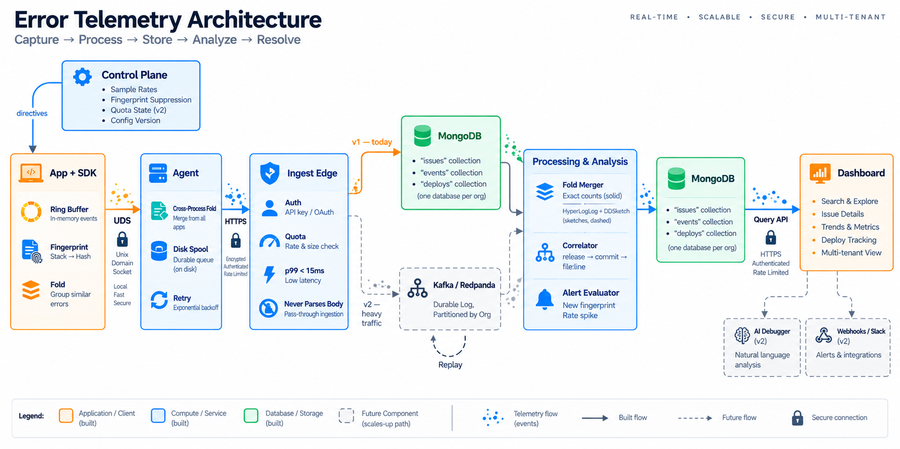

# BugBuster

An error-first observability platform. Unlike OpenTelemetry — which treats grouping as a backend
concern — BugBuster fingerprints and folds duplicate errors **client-side, in the SDK**, before
they ever touch the network. A 50,000-event error storm becomes a handful of aggregate records
plus a few full-fidelity exemplars, computed where the storm is happening, not after it's already
cost you the bandwidth.



Solid-outlined boxes are built and running today (v1); dashed boxes — Kafka/Redpanda, sketch
aggregation, the AI Debugger, Slack/webhook alerts — are the documented scale-up path, not built
yet ([`ingest-pipeline.md`](docs/architecture/ingest-pipeline.md) §10 says what triggers each).

**Contents**

- [How it fits together](#how-it-fits-together)
- [Using BugBuster in your app](#using-bugbuster-in-your-app) — get a key, install the SDK, the code
- [Deploying: the Agent and where your app runs](#deploying-the-agent-and-where-your-app-runs) — the DevOps part
- [Seeing your data](#seeing-your-data) — dashboard and API
- [Operating the backend](#operating-the-backend) — for whoever runs the hosted service
- [Releasing the npm packages](#releasing-the-npm-packages)
- [Developing BugBuster locally](#developing-bugbuster-locally)
- [Repo map and design docs](#repo-map-and-design-docs)

---

## How it fits together

```text
your Node app  ── @bugbusterhq/sdk-node: capture → fingerprint → fold (errors) / buffer (logs)
     │
     │  Unix socket (same host)                     … or direct HTTPS, when no Agent can run
     ▼                                                  (serverless / PaaS — see below)
BugBuster Agent ── one per host: merges every service's batches, compresses, retries, spools
     │
     │  HTTPS  POST /ingest   (Authorization: Bearer <API key>)
     ▼
Backend ── one MongoDB database per organization  ── Query API  ──▶  Dashboard
```

Two kinds of telemetry travel the same pipeline, treated oppositely on purpose:

- **Errors are folded.** Identical errors collapse into one *issue* with a count, plus a few full
  example events (first, last, slowest, one per release, ...).
- **Logs are not.** `client.log.info("order placed", { orderId })` is stored as its own line —
  searchable by text, level, service, environment and time, with a live tail.

They meet at the **trace id**: every log line written during a request carries the same id as the
errors that request raised, so the dashboard jumps from an error straight to everything that
request logged.

**The hosted backend** is at **`https://backend-kunal-arora-1411s-projects.vercel.app`**
(ingest endpoint: `…/ingest`).

---

## Using BugBuster in your app

### 1. Get an API key

There is no self-serve signup yet. Ask the BugBuster maintainers for an organization; they create
it (see [Creating an organization](#creating-an-organization)) and give you an **API key**. That
key identifies your org on every request — treat it like a password: keep it in an environment
variable or your secret manager, never in source control.

### 2. Install the SDK

```bash
npm install @bugbusterhq/sdk-node
# or: pnpm add @bugbusterhq/sdk-node  /  yarn add @bugbusterhq/sdk-node
```

- **Node.js ≥ 20.** The package is ESM. From CommonJS, `require("@bugbusterhq/sdk-node")` works on
  Node ≥ 20.19 / ≥ 22.12 (which can `require()` ES modules); on older Node use `await import(...)`.
- **Application logs need `@bugbusterhq/sdk-node` ≥ 0.2.0.** 0.1.0 captures errors only.

### 3. Initialize once, at startup

```ts
import { init } from "@bugbusterhq/sdk-node";

export const bugbuster = init({
  project: "orders-api",                         // your service's name
  apiKey: process.env.BUGBUSTER_API_KEY!,        // from step 1
  environment: process.env.NODE_ENV ?? "production",
  release: process.env.GIT_SHA,                  // optional but recommended: ties issues to deploys

  // Only needed when this app runs WITHOUT an Agent (serverless/PaaS — see "Deploying" below):
  backendUrl: "https://backend-kunal-arora-1411s-projects.vercel.app/ingest",
});
```

Create this **once per process** and import it where you need it. `init()` never throws into your
code at runtime and never blocks a request: captures go into an in-memory buffer and are sent in
the background every ~5 seconds. If the buffer fills or the network is down, data is dropped and
*counted* — your app is never slowed down or crashed by telemetry.

<details>
<summary><b>All <code>init()</code> options</b></summary>

| Option | Default | What it does |
|---|---|---|
| `project` | — (required) | Service name; also used as the log `service.name`. |
| `apiKey` | — (required) | Your organization's API key. |
| `environment` | `"production"` | Shown on every issue and log line; filterable in the dashboard. |
| `release` | — | Your version or commit SHA. Lets you see which release introduced an error. |
| `agentSocketPath` | `/var/run/bugbuster/agent.sock` | Where to look for the Agent. Checked once at `init()`. |
| `backendUrl` | — | Ingest URL for direct mode (used only when no Agent is found). |
| `minLogLevel` | `"info"` | `debug` / `info` / `warn` / `error`. Lower levels are discarded almost for free. |
| `flushMaxDelayMs` | `5000` | How often buffered data is sent. |
| `shutdownFlushTimeoutMs` | `2000` | Upper bound on `shutdown()`, so it never delays a deploy. |
| `ringBufferBytes` | 8 MB | Memory cap for captured errors. |
| `logBufferBytes` | 4 MB | Separate memory cap for log lines — a log flood can never evict an error. |
| `flushMaxBatchBytes` | 512 KB | Max size of one request; bigger flushes are split. |
| `maxLiveFingerprints` | 10,000 | Distinct error types folded per flush window. |

</details>

### 4. Capture errors

```ts
try {
  await chargeCard(order);
} catch (err) {
  bugbuster.captureException(err);
  throw err;
}

bugbuster.captureMessage("inventory below threshold");   // something worth knowing, not an Error
```

The SDK does **not** install global `uncaughtException` / `unhandledRejection` handlers for you
(that is your process's policy to decide). If you want them reported:

```ts
process.on("unhandledRejection", (reason) => bugbuster.captureException(reason));
process.on("uncaughtException", async (err) => {
  bugbuster.captureException(err);
  await bugbuster.shutdown();   // flush before exiting
  process.exit(1);
});
```

### 5. Express (or any Connect-style framework)

```ts
import express from "express";
import { createExpressIntegration } from "@bugbusterhq/sdk-node";
import { bugbuster } from "./bugbuster.js";

const bb = createExpressIntegration(bugbuster, {
  logRequests: { ignorePaths: ["/healthz"] },  // optional: one access-log line per request
});

const app = express();
app.use(bb.requestHandler);          // FIRST, before any route: trace id per request + 5xx safety net
bb.instrumentConsole();              // console.error(err) / console.warn(...) become captured errors
// bb.instrumentConsole({ logs: true });  // ...and also ship console.log/info/debug as log lines

app.get("/orders/:id", (req, res) => {
  bb.log.info("order lookup", { orderId: req.params.id });   // carries this request's trace id
  res.json(/* ... */);
});

// your error middleware, LAST:
app.use((err, req, res, next) => {
  bb.captureException(err);
  res.status(500).send("Something went wrong");
});
```

`bb.requestHandler` also reports any 5xx response that nothing else reported (as a
`HandledHttpError`), without double-counting requests where you already called
`captureException`. Query strings are never logged.

### 6. Application logs

```ts
bugbuster.log.info("order placed", { orderId: "o_1042", total: 129.5 });
bugbuster.log.warn("slow query", { table: "invoices", durationMs: 2431 });
bugbuster.log.error("payment failed", { reason: err.message });
bugbuster.log.debug("cache miss", { key });     // dropped unless minLogLevel: "debug"
```

The second argument is structured `fields` — searchable context, not string-concatenated into the
message. Before anything leaves your process:

- **Secrets are redacted.** Values under keys like `password`, `token`, `secret`, `apiKey`,
  `authorization`, `cookie`, `ssn` (at any depth) become `[redacted]`; emails, bearer tokens and
  card-like numbers inside strings are scrubbed too.
- **Size is bounded.** Messages are capped at 8,192 characters and `fields` at 16 KB; circular references,
  `BigInt`, `Map`, `Error` and throwing getters are handled safely.

**Already using pino or winston?** Keep your logger calls; add a destination:

```ts
import pino from "pino";
import { createLogStream } from "@bugbusterhq/sdk-node";

const logger = pino(createLogStream(bugbuster));
// winston: new winston.transports.Stream({ stream: createLogStream(bugbuster) })
```

Logs are kept for 7 days by default (set by the backend operator).

### 7. Flush on shutdown

```ts
process.on("SIGTERM", async () => {
  server.close();
  await bugbuster.shutdown();   // sends what's buffered; never takes longer than ~2 s
  process.exit(0);
});
```

Without this, up to the last ~5 seconds of telemetry is lost on every deploy or restart.

Full SDK reference: [`packages/sdk-node/README.md`](packages/sdk-node/README.md).

---

## Deploying: the Agent and where your app runs

How telemetry leaves your app depends on where it runs. **The SDK picks the mode by itself** at
`init()`: if an Agent socket exists at `agentSocketPath` it uses the Agent, otherwise it posts
directly to `backendUrl`.

| Where your app runs | Use | Why |
|---|---|---|
| A VM / bare-metal server / EC2, one or more Node services | **The Agent** (recommended) | One Agent per host merges all services' errors, compresses, retries with backoff, and spools to disk if the backend is unreachable. |
| Serverless (Vercel, Lambda, Cloud Functions), PaaS dynos | **Direct mode** — set `backendUrl` | No long-lived host process to run a daemon on. |
| Containers / Kubernetes | Direct mode, or an Agent sidecar | A sidecar works if the app and Agent containers share the socket via a volume. |

### Option A — install the Agent on the host (Linux, systemd)

Prerequisites on the host: **Node.js ≥ 22.15**, `git`, and `sudo`. pnpm is installed for you via
corepack if missing.

```bash
curl -fsSL https://raw.githubusercontent.com/kunal-arora-1411/BugBuster/main/packages/agent/scripts/install.sh \
  | sudo bash -s -- \
    --api-key "$BUGBUSTER_API_KEY" \
    --backend-url https://backend-kunal-arora-1411s-projects.vercel.app/ingest
```

This builds the Agent from source into `/opt/bugbuster/source` and installs it as the systemd
service **`bugbuster-agent`** running as a dedicated `bugbuster` user — independent of PM2 or your
app's own unit, so it survives app deploys. Config is written to `/etc/bugbuster/agent.env`
(mode 600).

| Installer flag | Default |
|---|---|
| `--socket-path` | `/var/run/bugbuster/agent.sock` (the SDK's default — leave it unless you must change both) |
| `--spool-dir` | `/var/lib/bugbuster/spool` — failed batches wait here (up to 64 MB, 24 h) |
| `--commit` | `main` — **pin a tag or SHA in production**, e.g. `--commit v0.2.0` |
| `--install-dir` / `--user` / `--repo-url` | `/opt/bugbuster/source` / `bugbuster` / this repo |

Day-2 operations:

```bash
systemctl status bugbuster-agent          # is it running?
journalctl -u bugbuster-agent -f          # its logs
sudo bash /opt/bugbuster/source/packages/agent/scripts/uninstall.sh   # remove it
```

To upgrade, re-run the same install command with a newer `--commit`; it rebuilds in place and
restarts the service.

Then start your app **after** the Agent (the SDK checks for the socket once, at `init()`), with
no `backendUrl` needed. If you changed `--socket-path`, pass the same path as `agentSocketPath`.

> **Not yet verified on a production host:** whether an app running as a *different* user than
> `bugbuster` can connect to the socket with default permissions, and whether the socket directory
> under `/var/run` is recreated after a reboot. If telemetry stops arriving, check those first.

### Option B — direct mode (serverless / PaaS / containers)

Set `backendUrl` in `init()` (step 3 above) and make sure no Agent socket exists at
`agentSocketPath`. Each process then sends its own batches over HTTPS. You lose cross-service
merging and the disk spool; everything else works the same.

On serverless, call `await bugbuster.shutdown()` before your handler returns if the platform
freezes the process between invocations — otherwise buffered data may never be sent.

### Environment variables we recommend

| Variable | Used by | Example |
|---|---|---|
| `BUGBUSTER_API_KEY` | your app (`apiKey`) and the Agent installer | from your secret manager |
| `GIT_SHA` / your CI's commit var | your app (`release`) | `9f2c1e7` |
| `NODE_ENV` | your app (`environment`) | `production` |

---

## Seeing your data

### Dashboard

The dashboard is a single HTML file with no build step:
[`packages/dashboard/src/index.html`](packages/dashboard/src/index.html). Open it in a browser (or
run `pnpm --filter @bugbusterhq/dashboard dev` and go to <http://localhost:5173>). The backend URL
is pre-filled with the hosted backend; paste your **API key**.

- **Issues** — every error type with its count, users affected, durations, top endpoints and
  example events (with stack traces). A badge shows whether the count is exact or sampled.
- **Logs** — search, filter by level / service / environment / time, **Live** tail, and from any
  error example: *View logs for this request*.

Your API key is stored only in that browser's `localStorage` and sent only to the backend URL.

### Query API

```bash
KEY=$BUGBUSTER_API_KEY
API=https://backend-kunal-arora-1411s-projects.vercel.app

curl -H "Authorization: Bearer $KEY" "$API/issues?limit=20"
curl -H "Authorization: Bearer $KEY" "$API/issues/<fingerprint>/exemplars"
curl -H "Authorization: Bearer $KEY" "$API/logs?level=error&q=payment&limit=50"
```

Full reference: [`docs/api.md`](docs/api.md).

---

## Operating the backend

For whoever runs the hosted service.

### Configuration

| Env var | Default | Meaning |
|---|---|---|
| `BUGBUSTER_CONTROL_DB_URI` | — | MongoDB connection string. Holds `bugbuster_control` (orgs + API keys) and one `bugbuster_org_*` database per org. The Vercel entry point also accepts `MONGODB_URI` (what Vercel's MongoDB integration sets). |
| `PORT` | `8080` | HTTP port (ignored on Vercel). |
| `BUGBUSTER_LOG_RETENTION_DAYS` | `7` | Days to keep log lines (TTL index on receive time). `0` = keep forever. Blank = default. |

MongoDB Atlas works well; allowlist the backend's egress IPs (on Vercel that usually means
`0.0.0.0/0` plus a strong password) and never commit the URI.

### Deploying to Vercel

The backend's Vercel entry point is [`packages/backend/app.ts`](packages/backend/app.ts), with
[`packages/backend/vercel.json`](packages/backend/vercel.json) building the shared types first.
Point a Vercel project's root directory at `packages/backend`, set the env vars above, and deploy.

**The Vercel project is not connected to this GitHub repo** (no deployments are reported back to
GitHub) — so merging to `main` does *not* redeploy it. After merging backend changes, redeploy the
`backend` project from the Vercel dashboard, or with the CLI from its linked directory:

```bash
vercel deploy --prod
```

Connecting the project to the repo under *Vercel → Project → Settings → Git* makes `main` deploy
automatically.

Check it afterwards: `curl $API/issues` should return `{"error":"missing bearer token"}`, and
`curl -o /dev/null -w '%{http_code}' $API/logs` should return `401` (a `404` means the deployed
build predates application logs).

### Self-hosting elsewhere

Any Node ≥ 22.15 host works (zstd decompression needs it):

```bash
pnpm install && pnpm build
cd packages/backend
BUGBUSTER_CONTROL_DB_URI="mongodb+srv://..." PORT=8080 pnpm start
```

Put it behind TLS (a reverse proxy or your platform's load balancer); Agents should only ever talk
to it over HTTPS.

### Creating an organization

From a checkout of this repo, with access to the production database:

```bash
pnpm install && pnpm build
cd packages/backend
BUGBUSTER_CONTROL_DB_URI="mongodb+srv://..." \
  pnpm create-org <orgId> "<Org name>" bugbuster_org_<orgId> "$(openssl rand -hex 24)"
```

Arguments: `orgId`, display name, the org's own database name, and its API key. Hand the API key
to the customer over a secure channel. Each org's data lives in its own database, resolved from the
key before any query runs.

---

## Releasing the npm packages

`@bugbusterhq/types`, `@bugbusterhq/sdk-node` and `@bugbusterhq/agent` are published to npm
**by hand** — nothing publishes automatically on merge.

1. Bump `version` in all three `package.json` files (they move together) and merge to `main`.
2. From an up-to-date `main`, logged in to npm with publish rights on the `@bugbusterhq` scope:

   ```bash
   pnpm install && pnpm -r publish --access public
   ```

   Use **pnpm**, not `npm publish` — only pnpm rewrites the `workspace:^` dependencies between the
   packages into real version ranges. Each package rebuilds itself before publishing.
3. Tag it: `git tag v0.2.0 && git push origin v0.2.0`.

The SDK and Agent report their own `package.json` version to the backend, so no other place needs
updating.

---

## Developing BugBuster locally

Run the whole pipeline on your machine — SDK → Agent → backend → MongoDB → dashboard, nothing
mocked.

**Prerequisites:** Node.js ≥ 22.15, pnpm 10+, and Docker (or any MongoDB on `localhost:27017`).

```bash
pnpm install
pnpm build
docker compose -f infra/docker-compose.yml up -d     # MongoDB

cd packages/backend
pnpm create-org org_demo "Demo Org" bugbuster_org_demo demo-api-key
cd ../..
```

Then three terminals:

```bash
# A — backend
cd packages/backend
BUGBUSTER_CONTROL_DB_URI=mongodb://localhost:27017 PORT=8080 pnpm start
```

```bash
# B — Agent  (Windows: BUGBUSTER_AGENT_SOCKET=\\.\pipe\bugbuster-agent)
cd packages/agent
BUGBUSTER_AGENT_SOCKET=/tmp/bugbuster-agent.sock \
BUGBUSTER_BACKEND_URL=http://localhost:8080/ingest \
BUGBUSTER_API_KEY=demo-api-key \
pnpm start
```

```bash
# C — the instrumented demo app
cd examples/demo-app
BUGBUSTER_API_KEY=demo-api-key BUGBUSTER_AGENT_SOCKET=/tmp/bugbuster-agent.sock pnpm dev
```

Generate telemetry and look at it:

```bash
curl http://localhost:3000/throw          # twice → ONE issue with count 2 (that's the fold)
curl http://localhost:3000/throw
curl http://localhost:3000/orders/42      # a normal request — logged, not folded
curl http://localhost:3000/checkout       # an error plus the log lines leading up to it

curl -H "Authorization: Bearer demo-api-key" http://localhost:8080/issues
curl -H "Authorization: Bearer demo-api-key" "http://localhost:8080/logs?limit=10"
```

Or open the dashboard (`pnpm --filter @bugbusterhq/dashboard dev` → <http://localhost:5173>) with
backend URL `http://localhost:8080` and key `demo-api-key`.

### Tests

```bash
pnpm test:unit                                          # every package, no services needed
pnpm --filter @bugbusterhq/backend test:integration     # real mongod via mongodb-memory-server
pnpm --filter @bugbusterhq/demo-app test:integration    # the full SDK → Agent → backend pipeline
pnpm lint && pnpm typecheck && pnpm format:check
```

CI ([`.github/workflows/ci.yml`](.github/workflows/ci.yml)) runs all of the above on every pull
request. [`examples/demo-app/test/full-pipeline.test.ts`](examples/demo-app/test/full-pipeline.test.ts)
is the automated version of the walkthrough above; the step-by-step version is in
[`docs/runbook.md`](docs/runbook.md).

---

## Repo map and design docs

| Package | Role |
|---|---|
| [`packages/types`](packages/types) | The wire-format contract (envelope, event, issue, log, config) shared by every package. |
| [`packages/sdk-node`](packages/sdk-node) | The SDK inside your Node process: the hot path (<5 µs), fingerprinting, the in-process fold, logs. |
| [`packages/agent`](packages/agent) | The host-local daemon: cross-process merge, compression, retries, circuit breaker, disk spool. |
| [`packages/backend`](packages/backend) | Ingest + Query API; resolves each request to its org's own MongoDB database first. |
| [`packages/dashboard`](packages/dashboard) | Read-only viewer for issues and logs — one HTML file, no build step. |
| [`examples/demo-app`](examples/demo-app) | An instrumented Express app plus the real end-to-end test. |

Why it's built this way — read before changing the core:

- [`docs/architecture/ingest-pipeline.md`](docs/architecture/ingest-pipeline.md) — the full
  design: hot-path budget, the fold, sampling, the Agent, backpressure, and §10's growth triggers
  (what's deliberately not built yet, and the measurement that would bring each piece in).
- [`docs/architecture/bugbuster-blueprint.html`](docs/architecture/bugbuster-blueprint.html) — the
  same architecture as eight drawn plates (open in a browser).
- [`docs/glossary.md`](docs/glossary.md) — plain-English definitions of every term used here.
- [`docs/api.md`](docs/api.md) · [`docs/schema.md`](docs/schema.md) — the Query API and the
  MongoDB schema.
