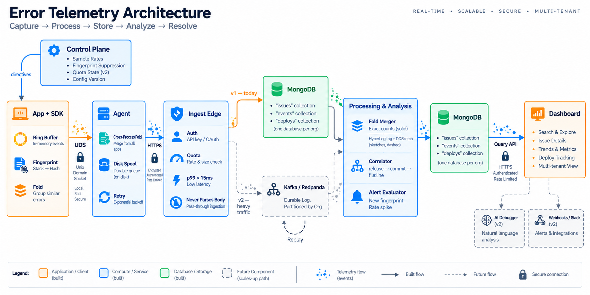

# BugBuster

An error-first observability platform. Unlike OpenTelemetry — which treats grouping as a backend
concern — BugBuster fingerprints and folds duplicate errors **client-side, in the SDK**, before
they ever touch the network. A 50,000-event error storm becomes a handful of aggregate records
plus a few full-fidelity exemplars, computed where the storm is happening, not after it's already
cost you the bandwidth.

BugBuster is **self-hosted**: you run the backend (a Node service plus MongoDB) yourself, and your
applications report to it through the npm SDK.



Solid-outlined boxes are built and running today (v1); dashed boxes — Kafka/Redpanda, sketch
aggregation, the AI Debugger, Slack/webhook alerts — are the documented scale-up path, not built
yet ([`ingest-pipeline.md`](docs/architecture/ingest-pipeline.md) §10 says what triggers each).

**Contents**

- [How it fits together](#how-it-fits-together)
- [Self-hosting the backend](#self-hosting-the-backend) — run it, configure it, create organizations
- [Using BugBuster in your app](#using-bugbuster-in-your-app) — install the SDK, the code
- [Deploying: the Agent and where your app runs](#deploying-the-agent-and-where-your-app-runs) — the DevOps part
- [Seeing your data](#seeing-your-data) — dashboard and API (Swagger UI at `/docs`)
- [Releasing the npm packages](#releasing-the-npm-packages)
- [Developing BugBuster locally](#developing-bugbuster-locally)
- [Repo map and design docs](#repo-map-and-design-docs)

---

## How it fits together

```text
your Node app  ── @bugbusterhq/sdk-node: capture → fingerprint → fold (errors) / buffer (logs)
     │
     │  Unix socket (same host)                     … or direct HTTPS, when no Agent can run
     ▼                                                  (serverless / PaaS — see below)
BugBuster Agent ── one per host: merges every service's batches, compresses, retries, spools
     │
     │  HTTPS  POST /ingest   (Authorization: Bearer <API key>)
     ▼
Backend ── one MongoDB database per organization  ── Query API  ──▶  Dashboard
```

Two kinds of telemetry travel the same pipeline, treated oppositely on purpose:

- **Errors are folded.** Identical errors collapse into one *issue* with a count, plus a few full
  example events (first, last, slowest, one per release, ...).
- **Logs are not.** `client.log.info("order placed", { orderId })` is stored as its own line —
  searchable by text, level, service, environment and time, with a live tail.

They meet at the **trace id**: every log line written during a request carries the same id as the
errors that request raised, so the dashboard jumps from an error straight to everything that
request logged, in every service it passed through.

Throughout this README, **`https://bugbuster.example.com`** stands for wherever *you* deploy the
backend.

---

## Self-hosting the backend

You need **Node.js ≥ 22.15** (the backend uses Node's built-in zstd) and a **MongoDB**: a free
[MongoDB Atlas](https://www.mongodb.com/cloud/atlas) cluster, your own server, or
`docker compose -f infra/docker-compose.yml up -d` for a local one.

### Configuration

| Env var | Default | Meaning |
|---|---|---|
| `BUGBUSTER_CONTROL_DB_URI` | — | MongoDB connection string. Holds `bugbuster_control` (orgs + API keys) and one `bugbuster_org_*` database per org. The Vercel entry point also accepts `MONGODB_URI` (what Vercel's MongoDB integration sets). |
| `PORT` | `8080` | HTTP port (ignored on Vercel). |
| `BUGBUSTER_LOG_RETENTION_DAYS` | `7` | Default days to keep log lines (TTL index on receive time). `0` = keep forever. Blank = default. Each org can override it; see [Storage](#storage). |
| `BUGBUSTER_ADMIN_TOKEN` | unset | Enables `POST /admin/orgs` (create organizations and API keys over HTTP). At least 32 characters: generate one with `openssl rand -hex 32`. **Unset = the admin route doesn't exist (404).** |
| `BUGBUSTER_BREVO_API_KEY` | unset | Turns on [email alerts](#email-alerts), sent through your Brevo account. Unset = no email is ever sent. |
| `BUGBUSTER_ALERTS_FROM` | — | The sender address, verified in Brevo. Required with the Brevo key. |
| `BUGBUSTER_ALERTS_FROM_NAME` | `BugBuster` | The sender name. |
| `BUGBUSTER_DASHBOARD_URL` | unset | Where your dashboard is served, e.g. `https://dashboard.example.com`. Each alert then links straight to its issue. |
| `BUGBUSTER_ALERTS_MAX_PER_HOUR` | `10` | Most alert emails one organization gets per hour. New errors past that wait and go out together. |
| `BUGBUSTER_CRON_SECRET` | unset | At least 16 characters. Enables `/internal/alerts/run` for a scheduler. On Vercel you can set `CRON_SECRET` instead, which Vercel Cron sends by itself. |

A mistake in the alert settings (a missing or invalid sender, say) turns alerts off and logs why;
it never stops the backend.

Keep the MongoDB URI, the admin token and the Brevo key in your platform's secret settings, never
in the repo. On
Atlas, allowlist the backend's egress IPs (on Vercel that usually means `0.0.0.0/0` plus a strong
database password).

### Option A — any Node host

```bash
pnpm install && pnpm build
cd packages/backend
BUGBUSTER_CONTROL_DB_URI="mongodb+srv://..." BUGBUSTER_ADMIN_TOKEN="..." PORT=8080 pnpm start
```

Run it under a process manager (systemd, PM2, a container) and put it behind TLS: a reverse proxy
or your platform's load balancer. Agents and SDKs should only ever reach it over HTTPS.

### Option B — Vercel

The backend's Vercel entry point is [`packages/backend/app.ts`](packages/backend/app.ts), with
[`packages/backend/vercel.json`](packages/backend/vercel.json) building the shared types first.
Point a Vercel project's root directory at `packages/backend`, set the env vars above, and deploy.

Connect the Vercel project to your Git repository so `main` deploys automatically; otherwise run
`vercel deploy --prod` after merging backend changes.

### Check that it's up

```bash
API=https://bugbuster.example.com
curl $API/issues                                   # {"error":"missing bearer token"}
curl -o /dev/null -w '%{http_code}\n' $API/logs     # 401 (a 404 means a build older than logs)
```

Then open `$API/docs` for the interactive API reference (Swagger UI).

### Managing organizations: the admin page

Every application reports into an **organization**, and each organization's data lives in its own
MongoDB database (`bugbuster_org_<orgId>`), chosen from its API key before any query runs. Create
one per team or customer.

With `BUGBUSTER_ADMIN_TOKEN` set, the backend serves an admin page at **`/admin`**
(`https://bugbuster.example.com/admin`). Sign in with the admin token; it is kept only for that
browser tab. From there you can:

- **Create organizations.** Their first API key is shown once, with a copy button.
- **Give each service or person its own key**, and **revoke** one without affecting the others.
  The list shows when each key was last used, so you can tell which are still needed.
- **Disable an organization**, which refuses all of its keys for both sending and reading, with
  `403 organization is disabled`. Its data is kept, and enabling it again restores access.
- **Rename** an organization or change its **log retention**.
- See what each organization **stores**, and delete leftover example events (see [Storage](#storage)).
- Read the **activity** history of every change made through admin.

Revoking a key or disabling an organization takes effect at once on the instance that handled it,
and **within a minute on every other backend instance**, which is how long a key stays cached.

**API keys are shown only once.** Only a hash is stored, so copy each new key straight away and
hand it over through a secure channel. If one is lost, create another and revoke the old one.
`orgId` is permanent: lowercase letters, digits, `-` and `_`, up to 40 characters.

Everything the page does is also an API call, documented in `/docs`:

```bash
curl -X POST https://bugbuster.example.com/admin/orgs \
  -H "Authorization: Bearer $BUGBUSTER_ADMIN_TOKEN" \
  -H "Content-Type: application/json" \
  -d '{"orgId": "acme", "name": "Acme Corp", "keyName": "checkout-api production"}'
```

```json
{ "orgId": "acme", "name": "Acme Corp", "dbName": "bugbuster_org_acme", "keyId": "key_…", "apiKey": "bb_…" }
```

**Or with the CLI**, from a checkout with access to the database (no admin token needed):

```bash
pnpm install && pnpm build
cd packages/backend
BUGBUSTER_CONTROL_DB_URI="mongodb+srv://..." \
  pnpm create-org <orgId> "<Org name>" bugbuster_org_<orgId> "$(openssl rand -hex 24)"
```

**Upgrading from a backend without named keys:** nothing to do. On startup, each organization's
existing key is copied in as "Original key" and keeps working, including on instances still running
the old version during a rolling deploy.

### Email alerts

Each organization can get an email when its services report an error BugBuster hasn't seen before.
Emails go out through **your Brevo account**, from an address you verify there; you choose who gets
them, per organization, on the admin page.

**Set up Brevo (once):**

1. Create a [Brevo](https://www.brevo.com) account.
2. Under **Senders, domains & dedicated IPs**, add the sender address alerts should come from and
   verify it. Prefer an address on a domain you own (`alerts@yourdomain.com`), and authenticate the
   domain there (Brevo gives you the DNS records). Mail "from" a `@gmail.com` address sent through
   Brevo tends to land in spam.
3. Under **SMTP & API → API keys**, create an API key.
4. Set `BUGBUSTER_BREVO_API_KEY`, `BUGBUSTER_ALERTS_FROM` and, so emails link to the issue,
   `BUGBUSTER_DASHBOARD_URL` on the backend, then restart or redeploy it.

Brevo's free plan sends up to about 300 emails a day across your whole account. That is plenty for
alerts (see the limits below), but every organization's alerts share it.

**Turn alerts on for an organization:** open `/admin`, select the organization, and fill in
**Email alerts**: tick *Send email alerts*, add recipients (up to 20; each gets their own copy),
optionally limit it to some services or environments (most teams use `production`), **Save alerts**,
then **Send test email** to check delivery.

**What sends an email, and what doesn't:**

- A **new issue**: an error BugBuster has never seen in that organization. New errors that arrive
  together share one email, which lists up to ten of them.
- An existing issue appearing in an environment or service it hadn't been seen in before. So with
  alerts limited to `production`, an error first seen in staging alerts when it reaches production.
- Not the same error happening again, and not issues from before alerts were switched on.
- Not an error whose fingerprint changed only because a service upgraded its SDK (0.3 added the
  service to fingerprints): an older issue with the same error, service and code location counts as
  the same error.
- At most `BUGBUSTER_ALERTS_MAX_PER_HOUR` emails per organization per hour (default 10). Past that,
  new errors wait and go out together in the next email the hour allows.

**When emails go out:** right after the ingest request that brought the new error. Ones that had to
wait (the hourly cap, a failed send) go out on the next new error, or when a scheduler calls
`/internal/alerts/run`:

- A long-running Node backend also does this itself every minute.
- On Vercel, `vercel.json` already has a Vercel Cron job that calls it once a day; set `CRON_SECRET`
  in the project for it to work. For more often than daily, call it from any scheduler, for example
  every 5 minutes from cron-job.org or a GitHub Actions schedule:

  ```bash
  curl -fsS https://bugbuster.example.com/internal/alerts/run -H "Authorization: Bearer $BUGBUSTER_CRON_SECRET"
  ```

The admin page shows each organization's last alert, how many went out in the last hour, and why the
last attempt failed, if it did (Brevo's reason, such as an unverified sender).

### Storage

Everything lives in MongoDB, and what grows is bounded:

- **Logs** are deleted after the retention period (7 days unless configured). Each org can have its
  own: create it with `"logRetentionDays": 30`, or change it later. The change applies to that org's
  data immediately; `null` returns it to the backend default and `0` keeps its logs forever.

  ```bash
  curl -X PATCH https://bugbuster.example.com/admin/orgs/acme \
    -H "Authorization: Bearer $BUGBUSTER_ADMIN_TOKEN" -H "Content-Type: application/json" \
    -d '{"logRetentionDays": 30}'
  ```

- **Issues** are one document per kind of error, however often it happens, and each keeps at most
  six example events. Examples past that are not stored.
- **New logs collections are compressed with zstd**, which stores repetitive log text in several
  times less disk than MongoDB's default. A collection's compressor is fixed when it is created, so
  orgs whose logs collection already existed keep the old one; the storage report shows which.

**See what each org costs** before changing anything:

```bash
curl https://bugbuster.example.com/admin/storage -H "Authorization: Bearer $BUGBUSTER_ADMIN_TOKEN"
```

It lists, largest org first: documents, data size, size on disk and index size for logs, issues and
example events; the compressor in use; log lines received per day for the last 7 days with their
estimated size; and how many stored example events no issue uses (`?orgId=acme` for one org).

**After upgrading from a backend older than this release**, remove the example events earlier
versions stored but never showed. It only deletes events no issue references, is safe to re-run,
and `--dry-run` just counts:

```bash
cd packages/backend
BUGBUSTER_CONTROL_DB_URI="mongodb+srv://..." pnpm cleanup-events --dry-run
BUGBUSTER_CONTROL_DB_URI="mongodb+srv://..." pnpm cleanup-events
```

---

## Using BugBuster in your app

> **Using an AI coding agent?** [`docs/ai-agent-integration.md`](docs/ai-agent-integration.md) has a
> ready-made prompt to paste into Claude Code, Cursor, Codex or Copilot in your service's
> repository. It does the steps below for you, on its own branch, without disturbing other open work.
> Already on 0.1 or 0.2? [`docs/upgrade-to-0.3.md`](docs/upgrade-to-0.3.md) has the prompt for
> upgrading.

### 1. Get an API key

Create an organization on your backend (see [Managing organizations](#managing-organizations-the-admin-page))
and take its **API key**. That key identifies your org on every request. Treat it like a password:
keep it in an environment variable or your secret manager, never in source control.

**Several microservices?** Use **one organization for the whole application**, not one per
service: the dashboard shows one organization at a time. Give each service its own named key on
the admin page (so you can revoke one without touching the others) and its own `project` name in
`init()`. Logs and issues from every service then appear together, with a **Service** column and
filter on both views.

### 2. Install the SDK

```bash
npm install @bugbusterhq/sdk-node
# or: pnpm add @bugbusterhq/sdk-node  /  yarn add @bugbusterhq/sdk-node
```

- **Node.js ≥ 20.** The package is ESM. From CommonJS, `require("@bugbusterhq/sdk-node")` works on
  Node ≥ 20.19 / ≥ 22.12 (which can `require()` ES modules); on older Node use `await import(...)`.
- **Application logs need `@bugbusterhq/sdk-node` ≥ 0.2.0.** 0.1.0 captures errors only.

### 3. Initialize once, at startup

```ts
import { init } from "@bugbusterhq/sdk-node";

export const bugbuster = init({
  project: "orders-api",                         // your service's name
  apiKey: process.env.BUGBUSTER_API_KEY!,        // from step 1
  environment: process.env.NODE_ENV ?? "production",
  release: process.env.GIT_SHA,                  // optional but recommended: ties issues to deploys

  // Only needed when this app runs WITHOUT an Agent (serverless/PaaS — see "Deploying" below):
  backendUrl: process.env.BUGBUSTER_BACKEND_URL,   // e.g. https://bugbuster.example.com/ingest
});
```

Create this **once per process** and import it where you need it. `init()` never throws into your
code at runtime and never blocks a request: captures go into an in-memory buffer and are sent in
the background every ~5 seconds. If the buffer fills or the network is down, data is dropped and
*counted* — your app is never slowed down or crashed by telemetry.

<details>
<summary><b>All <code>init()</code> options</b></summary>

| Option | Default | What it does |
|---|---|---|
| `project` | — (required) | Service name; also used as the log `service.name`. |
| `apiKey` | — (required) | Your organization's API key. |
| `environment` | `"production"` | Shown on every issue and log line; filterable in the dashboard. |
| `release` | — | Your version or commit SHA. Lets you see which release introduced an error. |
| `agentSocketPath` | `/var/run/bugbuster/agent.sock` | Where to look for the Agent. Checked once at `init()`. |
| `backendUrl` | — | Ingest URL for direct mode (used only when no Agent is found). |
| `minLogLevel` | `"info"` | `debug` / `info` / `warn` / `error`. Lower levels are discarded almost for free. |
| `flushMaxDelayMs` | `5000` | How often buffered data is sent. |
| `shutdownFlushTimeoutMs` | `2000` | Upper bound on `shutdown()`, so it never delays a deploy. |
| `ringBufferBytes` | 8 MB | Memory cap for captured errors. |
| `logBufferBytes` | 4 MB | Separate memory cap for log lines — a log flood can never evict an error. |
| `flushMaxBatchBytes` | 512 KB | Max size of one request; bigger flushes are split. |
| `maxLiveFingerprints` | 10,000 | Distinct error types folded per flush window. |

</details>

### 4. Capture errors

```ts
try {
  await chargeCard(order);
} catch (err) {
  bugbuster.captureException(err);
  throw err;
}

bugbuster.captureMessage("inventory below threshold");   // something worth knowing, not an Error
```

The SDK does **not** install global `uncaughtException` / `unhandledRejection` handlers for you
(that is your process's policy to decide). If you want them reported:

```ts
process.on("unhandledRejection", (reason) => bugbuster.captureException(reason));
process.on("uncaughtException", async (err) => {
  bugbuster.captureException(err);
  await bugbuster.shutdown();   // flush before exiting
  process.exit(1);
});
```

### 5. Express (or any Connect-style framework)

```ts
import express from "express";
import { createExpressIntegration } from "@bugbusterhq/sdk-node";
import { bugbuster } from "./bugbuster.js";

const bb = createExpressIntegration(bugbuster, {
  logRequests: { ignorePaths: ["/healthz"] },  // optional: one access-log line per request
});

const app = express();
app.use(bb.requestHandler);          // FIRST, before any route: trace id per request + 5xx safety net
bb.instrumentConsole();              // console.error(err) / console.warn(...) become captured errors
// bb.instrumentConsole({ logs: true });  // ...and also ship console.log/info/debug as log lines

app.get("/orders/:id", (req, res) => {
  bb.log.info("order lookup", { orderId: req.params.id });   // carries this request's trace id
  res.json(/* ... */);
});

// your error middleware, LAST:
app.use((err, req, res, next) => {
  bb.captureException(err);
  res.status(500).send("Something went wrong");
});
```

`bb.requestHandler` also reports any 5xx response that nothing else reported (as a
`HandledHttpError`), without double-counting requests where you already called
`captureException`. Query strings are never logged.

#### One request across several services

When service A calls service B while handling a request, B can join A's trace. Then
*What this request logged* (on an issue) and the Logs view's trace filter show the lines from both
services, in order, each labeled with its service. Two pieces, both in the SDK (0.3.0+):

- **Receiving:** `bb.requestHandler` continues the caller's trace when the request carries a W3C
  `traceparent` header (or an `X-Request-Id`). Nothing to set up.
- **Calling:** pass the trace on. For `fetch`, once at startup:

  ```ts
  bb.instrumentFetch();                                         // every fetch during a request
  bb.instrumentFetch({ propagateTo: ["http://auth-service"] }); // or only to your own services
  ```

  For axios, got or `http`, add the headers yourself:
  `axios.get(url, { headers: bb.traceHeaders() })`, or once with an interceptor:
  `axios.interceptors.request.use((c) => { Object.assign(c.headers, bb.traceHeaders()); return c; })`.

`traceparent` is the standard OpenTelemetry uses, so traces also continue through services
instrumented with it. Use `propagateTo` to keep trace ids from being sent to outside APIs.

#### Which service caused it (0.4.0+)

When the database times out in `inventory`, `orders` fails because inventory did, and `checkout`
because orders did: three issues for one failure. With the same two pieces above in place, the
dashboard says so — *caused by …* on each symptom's row, and a **Cause and effect** block on the
issue with the likely root cause one click away. How it works without keeping every trace:

- A service answering a **traced** caller with a 5xx adds `X-BB-Cause: <fingerprint>` to the
  response: which issue it failed with. Browsers and outside clients send no `traceparent`, so they
  never get it. Turn it off with `createExpressIntegration(client, { causeHeader: false })`.
- An instrumented `fetch` reads that header, and every error the calling request captures after it
  is counted against that issue — inside the SDK's fold, so 50,000 failures still cost one record.
  For axios, got or `http`, report the response yourself: `bb.noteDownstreamResponse(res)`.

To see it with no app of your own, run three chained services against your backend:
`BUGBUSTER_API_KEY=<key> node examples/root-cause-demo/traffic.mjs` (after `pnpm build`).

Design: [`docs/architecture/root-cause-graph.md`](docs/architecture/root-cause-graph.md).

### 6. Application logs

```ts
bugbuster.log.info("order placed", { orderId: "o_1042", total: 129.5 });
bugbuster.log.warn("slow query", { table: "invoices", durationMs: 2431 });
bugbuster.log.error("payment failed", { reason: err.message });
bugbuster.log.debug("cache miss", { key });     // dropped unless minLogLevel: "debug"
```

The second argument is structured `fields` — searchable context, not string-concatenated into the
message. Before anything leaves your process:

- **Secrets are redacted.** Values under keys like `password`, `token`, `secret`, `apiKey`,
  `authorization`, `cookie`, `ssn` (at any depth) become `[redacted]`; emails, bearer tokens and
  card-like numbers inside strings are scrubbed too.
- **Size is bounded.** Messages are capped at 8,192 characters and `fields` at 16 KB; circular references,
  `BigInt`, `Map`, `Error` and throwing getters are handled safely.

**Already using pino or winston?** Keep your logger calls; add a destination:

```ts
import pino from "pino";
import { createLogStream } from "@bugbusterhq/sdk-node";

const logger = pino(createLogStream(bugbuster));
// winston: new winston.transports.Stream({ stream: createLogStream(bugbuster) })
```

Logs are kept for 7 days by default (`BUGBUSTER_LOG_RETENTION_DAYS` on the backend, or a per-org
setting; see [Storage](#storage)).

### 7. Flush on shutdown

```ts
process.on("SIGTERM", async () => {
  server.close();
  await bugbuster.shutdown();   // sends what's buffered; never takes longer than ~2 s
  process.exit(0);
});
```

Without this, up to the last ~5 seconds of telemetry is lost on every deploy or restart.

Full SDK reference: [`packages/sdk-node/README.md`](packages/sdk-node/README.md).

---

## Deploying: the Agent and where your app runs

How telemetry leaves your app depends on where it runs. **The SDK picks the mode by itself** at
`init()`: if an Agent socket exists at `agentSocketPath` it uses the Agent, otherwise it posts
directly to `backendUrl`.

| Where your app runs | Use | Why |
|---|---|---|
| A VM / bare-metal server / EC2, one or more Node services | **The Agent** (recommended) | One Agent per host merges all services' errors, compresses, retries with backoff, and spools to disk if the backend is unreachable. |
| Serverless (Vercel, Lambda, Cloud Functions), PaaS dynos | **Direct mode** — set `backendUrl` | No long-lived host process to run a daemon on. |
| Containers / Kubernetes | Direct mode, or an Agent sidecar | A sidecar works if the app and Agent containers share the socket via a volume. |

### Option A — install the Agent on the host (Linux, systemd)

Prerequisites on the host: **Node.js ≥ 22.15**, `git`, and `sudo`. pnpm is installed for you via
corepack if missing.

```bash
curl -fsSL https://raw.githubusercontent.com/kunal-arora-1411/BugBuster/main/packages/agent/scripts/install.sh \
  | sudo bash -s -- \
    --api-key "$BUGBUSTER_API_KEY" \
    --backend-url https://bugbuster.example.com/ingest
```

This builds the Agent from source into `/opt/bugbuster/source` and installs it as the systemd
service **`bugbuster-agent`** running as a dedicated `bugbuster` user — independent of PM2 or your
app's own unit, so it survives app deploys. Config is written to `/etc/bugbuster/agent.env`
(mode 600).

| Installer flag | Default |
|---|---|
| `--socket-path` | `/var/run/bugbuster/agent.sock` (the SDK's default — leave it unless you must change both) |
| `--spool-dir` | `/var/lib/bugbuster/spool` — failed batches wait here (up to 64 MB, 24 h) |
| `--commit` | `main` — **pin a tag or SHA in production**, e.g. `--commit v0.3.0` |
| `--install-dir` / `--user` / `--repo-url` | `/opt/bugbuster/source` / `bugbuster` / this repo |

Day-2 operations:

```bash
systemctl status bugbuster-agent          # is it running?
journalctl -u bugbuster-agent -f          # its logs
sudo bash /opt/bugbuster/source/packages/agent/scripts/uninstall.sh   # remove it
```

To upgrade, re-run the same install command with a newer `--commit`; it rebuilds in place and
restarts the service.

Then start your app **after** the Agent (the SDK checks for the socket once, at `init()`), with
no `backendUrl` needed. If you changed `--socket-path`, pass the same path as `agentSocketPath`.

> **Not yet verified on a production host:** whether an app running as a *different* user than
> `bugbuster` can connect to the socket with default permissions, and whether the socket directory
> under `/var/run` is recreated after a reboot. If telemetry stops arriving, check those first.

### Option B — direct mode (serverless / PaaS / containers)

Set `backendUrl` in `init()` (step 3 above) and make sure no Agent socket exists at
`agentSocketPath`. Each process then sends its own batches over HTTPS. You lose cross-service
merging and the disk spool; everything else works the same.

On serverless, call `await bugbuster.shutdown()` before your handler returns if the platform
freezes the process between invocations — otherwise buffered data may never be sent.

### Environment variables we recommend

| Variable | Used by | Example |
|---|---|---|
| `BUGBUSTER_API_KEY` | your app (`apiKey`) and the Agent installer | from your secret manager |
| `BUGBUSTER_BACKEND_URL` | your app (`backendUrl`, direct mode only) | `https://bugbuster.example.com/ingest` |
| `GIT_SHA` / your CI's commit var | your app (`release`) | `9f2c1e7` |
| `NODE_ENV` | your app (`environment`) | `production` |

---

## Seeing your data

### Dashboard

The dashboard is a single HTML file with no build step:
[`packages/dashboard/src/index.html`](packages/dashboard/src/index.html). Open it in a browser (or
run `pnpm --filter @bugbusterhq/dashboard dev` and go to <http://localhost:5173>). Enter your
backend's URL (it defaults to `http://localhost:8080`) and your **API key**.

- **Issues** — every error type with its count, users affected, durations, top endpoints and
  example events (with stack traces). A badge shows whether the count is exact or sampled. With
  more than one service, a **Service** column and filter appear; the same error in two services is
  two issues. An issue opens under its row with the failing request's log lines (from every service
  it went through) and a **Copy issue** button that copies it all as one report for an AI agent.
  `#issues/<fingerprint>` links straight to one issue, which is what alert emails use.
- **Logs** — search, filter by level / service / environment / time, **Live** tail, and from any
  error example: *View logs for this request*.

Your API key is stored only in that browser's `localStorage` and sent only to the backend URL.

### Query API

```bash
KEY=$BUGBUSTER_API_KEY
API=https://bugbuster.example.com

curl -H "Authorization: Bearer $KEY" "$API/issues?limit=20"
curl -H "Authorization: Bearer $KEY" "$API/issues/<fingerprint>/exemplars"
curl -H "Authorization: Bearer $KEY" "$API/logs?level=error&q=payment&limit=50"
```

Every backend also serves interactive docs at **`/docs`** (Swagger UI: click *Authorize*, paste a
key, then *Try it out*) and the OpenAPI 3.1 document at `/openapi.json`. A copy is committed at
[`docs/openapi.json`](docs/openapi.json) for Postman or client generators; the prose reference is
[`docs/api.md`](docs/api.md).

---

## Releasing the npm packages

`@bugbusterhq/types`, `@bugbusterhq/sdk-node` and `@bugbusterhq/agent` are published to npm
**by hand** — nothing publishes automatically on merge.

1. Bump `version` in all three `package.json` files (they move together) and merge to `main`.
2. From an up-to-date `main`, logged in to npm with publish rights on the `@bugbusterhq` scope:

   ```bash
   pnpm install && pnpm -r publish --access public
   ```

   Use **pnpm**, not `npm publish` — only pnpm rewrites the `workspace:^` dependencies between the
   packages into real version ranges. Each package rebuilds itself before publishing.
3. Tag it: `git tag v0.3.0 && git push origin v0.3.0`.

The SDK and Agent report their own `package.json` version to the backend, so no other place needs
updating.

**0.3.0:** the SDK groups errors per service, so the fingerprint of every error changes once.
After a service upgrades, its errors start new issues (with the same titles), and the old ones stop
growing. The backend accepts both old and new SDKs. It also follows one request across services
([One request across several services](#one-request-across-several-services)), and new trace ids
are W3C-style 32-hex ids instead of UUIDs. To upgrade a service with an AI coding agent, use
[`docs/upgrade-to-0.3.md`](docs/upgrade-to-0.3.md).

**0.4.0:** issues know which other service's issue caused them
([Which service caused it](#which-service-caused-it-040)). Both new wire fields are optional, so
any mix of old and new SDKs, Agents and backends keeps working; links appear once both sides of a
call run 0.4.0. Synthetic `HandledHttpError`s (a 5xx nothing reported) now have a fixed stack, so
each one starts a new issue once after the upgrade.

---

## Developing BugBuster locally

Run the whole pipeline on your machine — SDK → Agent → backend → MongoDB → dashboard, nothing
mocked.

**Prerequisites:** Node.js ≥ 22.15, pnpm 10+, and Docker (or any MongoDB on `localhost:27017`).

```bash
pnpm install
pnpm build
docker compose -f infra/docker-compose.yml up -d     # MongoDB

cd packages/backend
pnpm create-org org_demo "Demo Org" bugbuster_org_demo demo-api-key
cd ../..
```

Then three terminals:

```bash
# A — backend
cd packages/backend
BUGBUSTER_CONTROL_DB_URI=mongodb://localhost:27017 PORT=8080 pnpm start
```

```bash
# B — Agent  (Windows: BUGBUSTER_AGENT_SOCKET=\\.\pipe\bugbuster-agent)
cd packages/agent
BUGBUSTER_AGENT_SOCKET=/tmp/bugbuster-agent.sock \
BUGBUSTER_BACKEND_URL=http://localhost:8080/ingest \
BUGBUSTER_API_KEY=demo-api-key \
pnpm start
```

```bash
# C — the instrumented demo app
cd examples/demo-app
BUGBUSTER_API_KEY=demo-api-key BUGBUSTER_AGENT_SOCKET=/tmp/bugbuster-agent.sock pnpm dev
```

Generate telemetry and look at it:

```bash
curl http://localhost:3000/throw          # twice → ONE issue with count 2 (that's the fold)
curl http://localhost:3000/throw
curl http://localhost:3000/orders/42      # a normal request — logged, not folded
curl http://localhost:3000/checkout       # an error plus the log lines leading up to it

curl -H "Authorization: Bearer demo-api-key" http://localhost:8080/issues
curl -H "Authorization: Bearer demo-api-key" "http://localhost:8080/logs?limit=10"
```

Or open the dashboard (`pnpm --filter @bugbusterhq/dashboard dev` → <http://localhost:5173>) with
backend URL `http://localhost:8080` and key `demo-api-key`.

### Tests

```bash
pnpm test:unit                                          # every package, no services needed
pnpm --filter @bugbusterhq/backend test:integration     # real mongod via mongodb-memory-server
pnpm --filter @bugbusterhq/demo-app test:integration    # the full SDK → Agent → backend pipeline
pnpm lint && pnpm typecheck && pnpm format:check
```

CI ([`.github/workflows/ci.yml`](.github/workflows/ci.yml)) runs all of the above on every pull
request. [`examples/demo-app/test/full-pipeline.test.ts`](examples/demo-app/test/full-pipeline.test.ts)
is the automated version of the walkthrough above; the step-by-step version is in
[`docs/runbook.md`](docs/runbook.md).

---

## Repo map and design docs

| Package | Role |
|---|---|
| [`packages/types`](packages/types) | The wire-format contract (envelope, event, issue, log, config) shared by every package. |
| [`packages/sdk-node`](packages/sdk-node) | The SDK inside your Node process: the hot path (<5 µs), fingerprinting, the in-process fold, logs. |
| [`packages/agent`](packages/agent) | The host-local daemon: cross-process merge, compression, retries, circuit breaker, disk spool. |
| [`packages/backend`](packages/backend) | Ingest + Query API; resolves each request to its org's own MongoDB database first. |
| [`packages/dashboard`](packages/dashboard) | Read-only viewer for issues and logs — one HTML file, no build step. |
| [`examples/demo-app`](examples/demo-app) | An instrumented Express app plus the real end-to-end test. |

Why it's built this way — read before changing the core:

- [`docs/architecture/ingest-pipeline.md`](docs/architecture/ingest-pipeline.md) — the full
  design: hot-path budget, the fold, sampling, the Agent, backpressure, and §10's growth triggers
  (what's deliberately not built yet, and the measurement that would bring each piece in).
- [`docs/architecture/bugbuster-blueprint.html`](docs/architecture/bugbuster-blueprint.html) — the
  same architecture as eight drawn plates (open in a browser).
- [`docs/glossary.md`](docs/glossary.md) — plain-English definitions of every term used here.
- [`docs/architecture/root-cause-graph.md`](docs/architecture/root-cause-graph.md) — finding the
  root cause across services from folded data: the `X-BB-Cause` header and the issue graph.
- [`docs/api.md`](docs/api.md) · [`docs/schema.md`](docs/schema.md) — the Query API and the
  MongoDB schema.
